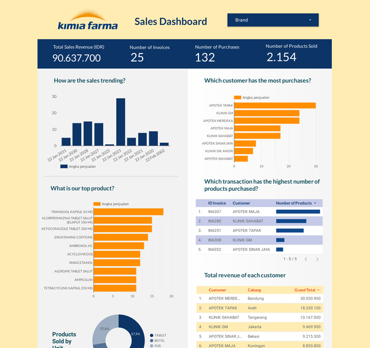
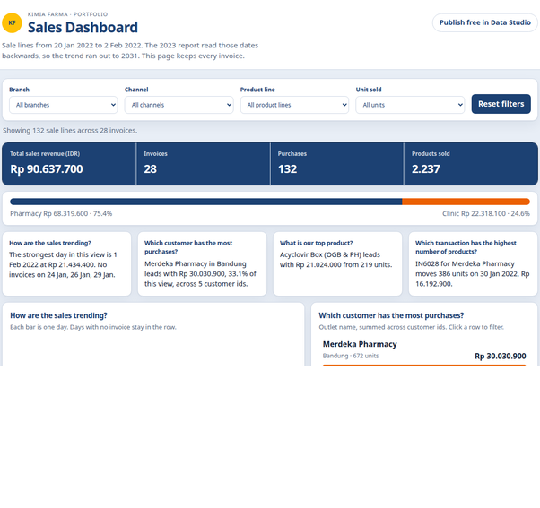

# Kimia Farma sales analysis

SQL and dashboard project from a virtual Data Science internship by Rakamin, in collaboration with Kimia Farma.

I took the program's sales sample from raw tables through joins and aggregates, then rebuilt the interactive dashboard for a portfolio. The data was modified for training, so it is safe to publish.

## Before and after

<table>
  <tr>
    <td align="center" valign="top" width="50%">
      <br />
      <sub>Original internship dashboard</sub>
    </td>
    <td align="center" valign="top" width="50%">
      <br />
      <sub>Rebuilt dashboard</sub>
    </td>
  </tr>
</table>

Open the new version: [`dashboard/index.html`](dashboard/index.html)

## What the dashboard answers

- Which outlet spent the most? Merdeka Pharmacy (Bandung), Rp 30.030.900
- How did sales move over time? Peak on 1 Feb 2022 at Rp 21.434.400
- What is the top product? Acyclovir Box, Rp 21.024.000
- Which invoice moved the most units? IN6028, 386 units

Totals with every invoice kept: **Rp 90.637.700** revenue, **28** invoices, **2.237** units.

## Pipeline

1. Load sales, customers, and products
2. Join into one sale-line table (`sql/01_sale_lines.sql`)
3. Aggregate by invoice and by outlet (`sql/02_invoice_totals.sql`, `sql/03_customer_totals.sql`)
4. Chart the results in the dashboard

Working tables: [`data/`](data/). Program source files: [`source/`](source/).

```bash
python3 scripts/rebuild_sales.py
```

## Fixes found while rebuilding

- Sale dates are day/month/year. `30/01/22` is 30 January 2022. The first report treated it as year/month/day, so the trend ran into 2031.
- The first invoice query used `HAVING COUNT(*) > 1` and dropped three real invoices (83 units). The old "products sold" number of 2.154 was that reduced total.

## If this were rebuilt in Data Studio

I did not rebuild the hosted Data Studio report here because of time. At a high level, these are the main steps:

1. Sign in at [datastudio.google.com](https://datastudio.google.com/) (formerly Looker Studio)
2. Create a data source and upload [`looker/kimia_farma_sales.csv`](looker/kimia_farma_sales.csv) (or Google Sheets)
3. Set `date` to Date type
4. Build scorecards for revenue, invoices, purchases, and units sold
5. Add a date column chart, outlet and product bar charts, a packaging pie, and customer / invoice tables
6. Use Kimia Farma navy `#1C4173` and orange `#EB6001`
7. Share the report as view-only for the portfolio

More detail lives in [`DATA_STUDIO.md`](DATA_STUDIO.md) if I pick this up later.
